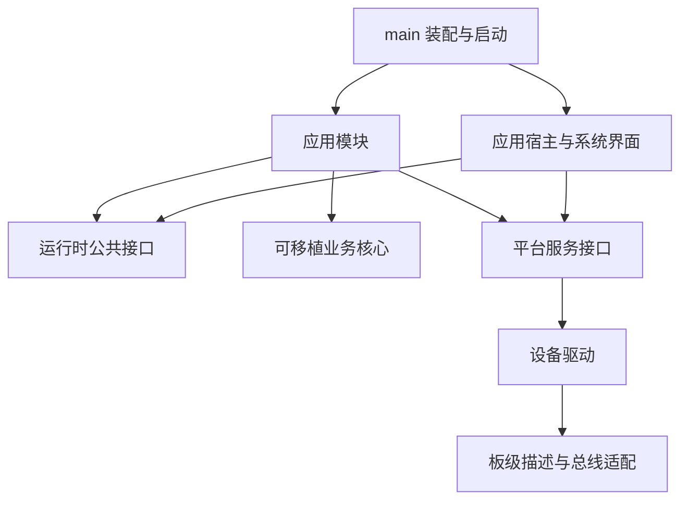

# ESPaperPlay v2 软件架构

状态：设计基线。日期：2026-11-01。实施进度与验收见 [roadmap.md](roadmap.md)。

## 1. 产品与工程边界

ESPaperPlay v2 是可扩展的多应用电子纸平台。阅读、相册、播放器、录音、天气、文件管理和网络工具使用相同的应用框架与平台服务。

已确定的约束：

- 主控保持 **ESP32-S3-WROOM-1-N16R8，16 MB Flash、8 MB PSRAM**。
- 复用现有 **GDEY075T7-T01 7.5 英寸 800×480 屏幕与触摸总成**，重新设计主板。
- 新板规划独立的屏幕、触摸、SD 和音频供电控制；旧板共用电源轨的事实必须保留在对应板级描述中。
- 无蓝牙耳机需求；本阶段不增加相关硬件或协议实现。
- 使用 ESP-IDF 6.1、FreeRTOS 和 C 接口；界面沿用 LVGL 9.5 系列，接入时锁定经过构建验证的具体版本。
- 原生应用编译进同一固件，通过静态描述符注册。应用共享地址空间，不提供进程级故障隔离或不可信第三方代码沙箱。

`v2/` 是独立 ESP-IDF 工程根目录，不链接旧版 `components/`。旧版工程保留在原 ESPaperPlay 仓库中作为迁移参考，起点为提交 [`0f6d7c3`](https://github.com/xiaobaoaaaaaa/ESPaperPlay/tree/0f6d7c349afdbbeb962a736d84036ce7f8487174)。修改或迁移旧代码前，先确认它依赖的线程、缓冲和电源假设。

## 2. 模块与依赖

图中表示主要使用关系。运行时通过注册的回调管理应用与服务，不引用任何具体应用的头文件。

| 模块 | 拥有的职责 | 禁止引入的依赖 |
| --- | --- | --- |
| `main` | 选择板级配置、装配实现、注册应用、安排启动 | 具体阅读、播放或页面业务逻辑 |
| 可移植运行时 | 应用注册与切换、实例代号、活动租约、休眠协商 | LVGL、FreeRTOS、ESP-IDF、设备驱动 |
| 应用宿主与系统界面 | 前台应用、导航、桌面、状态栏、通知、全局输入 | 具体文档解析与音频解码实现 |
| 应用 | 用户操作、应用状态、页面和服务调用 | 直接配置 GPIO、总线、面板刷新时序 |
| 可移植业务核心 | 文档解析、排版、索引及可独立验证的算法 | 页面对象、ESP-IDF 类型、全局设备状态 |
| 平台服务 | 显示、输入、音频、网络、存储、配置、电源、升级 | 具体应用页面与应用内部变量 |
| 驱动与板级适配 | 外设操作、时序、错误恢复、引脚和电源域 | 应用生命周期与界面业务 |

业务核心依赖的文件、字形测量、时钟等能力通过窄接口注入。公共接口使用明确的状态码与受控句柄；不把 LVGL 对象指针、驱动内部结构或可变全局状态向上暴露。运行时为支持静态分配公开的结构字段仍由模块独占，调用者不能直接修改。组件依赖必须无环，同层服务之间只引入明确需要的依赖。

## 3. 应用生命周期与后台会话

前台同时运行一个应用的主要页面，系统状态栏与弹窗作为受控覆盖层。离开前台时保存恢复所需的小型状态，释放不必要的页面与大块缓存；导航历史不等于保留所有页面对象。

应用描述符包括稳定 ID、名称、入口和生命周期回调。界面接入后再加入图标与所需硬件能力。首轮运行时使用最小的 `enter/leave` 契约，复杂页面由应用自行组织，避免预先引入无用途的生命周期层级。

切换必须遵守：

1. 验证目标应用存在，拒绝非法或重入切换。
2. 当前应用退出，新应用以新的实例代号进入。
3. 进入失败时清理失败实例，尝试恢复原应用；恢复也获得新的实例代号。
4. 恢复失败进入明确的无前台／错误状态，由系统界面接管，不保留悬空的“当前应用”。

应用 ID 表示应用种类，实例代号表示一次有效的前台生命周期。异步任务携带后者，结果交付时确认它仍有效；被丢弃的结果仍须释放自己拥有的缓冲。

实例代号校验只拒绝过期结果，不会自动停止正在执行的任务。真正的任务取消与完成确认由后续工作队列实现。当前运行时接口见 [`epp_runtime.h`](../../v2/components/epp_runtime/include/epp_runtime.h)。

播放、录音和下载是服务持有的独立会话，其寿命不绑定播放器或下载页面。页面关闭可以取消页面自己的请求，但不能隐式停止明确交给后台继续的会话。后台会话也必须有可查询的所有者、终止入口和资源预算。

## 4. 线程与通信

| 执行环境 | 工作 | 约束 |
| --- | --- | --- |
| UI 所有者任务 | 前台生命周期、导航、输入分发、LVGL 操作 | 不执行阻塞网络、解压、整章分页或音频 I/O |
| 显示任务 | 面板提交、BUSY 等待、刷新恢复 | 独占面板提交链，不访问可变页面对象 |
| 音频执行路径 | 采集、播放与有界缓冲处理 | 按需启动；控制锁不覆盖整个阻塞录放循环 |
| 计算工作队列 | 解析、分页、缩略图、索引 | 有限并发、可取消；与阻塞网络工作分开 |
| 网络执行环境 | HTTP/TLS、下载、流式传输 | 限制连接数、缓冲、超时与重试 |
| 系统协调任务 | 启动、资源与休眠事务 | 通过服务契约协调，不调用具体页面 |

以上是逻辑所有权，不是“一模块一任务”的任务清单。具体优先级、栈大小、CPU 亲和性与工作线程数量由负载测试确定。

可移植运行时由一个串行所有者调用，本身不包含锁。FreeRTOS 适配层负责把其他任务的请求投递给所有者；回调不能重入正在执行的切换或休眠事务。UI 接入后，所有普通 LVGL 操作集中在 UI 任务，符合 [LVGL 线程访问约束](https://lvgl.io/docs/open/9.5/integration/overview.html)。

通信采用三种明确形式：

- 短小、不会阻塞的查询直接调用并返回快照。
- 耗时命令返回任务句柄，具备完成、失败、取消及进度状态。
- 状态变化发送有类型事件；事件用于通知事实，不替代所有函数调用。

每条队列定义容量、消息所有权和满载行为。可合并的进度／状态通知保留最新值；不可丢弃的操作在满载时向调用者报告忙或失败。大图片、PCM 与文档块传递缓冲句柄，避免反复复制到事件队列。取消请求不代表在途 DMA 或文件写入已经停止，释放资源前必须确认终止完成。

## 5. 显示与输入

应用提交内容更新和交互／正文／图像等显示意图，由显示服务选择实际的局刷、全刷、灰阶和清残影策略。桌面、状态栏、弹窗与应用正文共用一条提交链。

初期使用 RGB565 渲染、输出时转换为 1/2 bpp 的路线。需要分别维护“最新渲染内容”“已提交内容”和“最后成功刷新状态”，不能在面板尚未成功完成刷新时把显示状态提前标为完成。刷新失败、复位或断电使面板历史状态失效时，执行能够重新建立有效画面的恢复流程。

缓冲策略保持有界：最多一个在途提交和一个可合并的待提交快照。合并必须以完整、相容的像素内容为基础；切换画质模式或页面代号时，不能把过期脏区套到新页面。驱动持有缓冲期间生产者不得修改它。

输入服务把触摸和按键归一化为事件，应用宿主负责前台焦点与全局操作映射。音量等全局命令直接进入对应服务；触摸坐标旋转与显示方向使用同一配置来源。

## 6. 音频、网络与远程管理

播放管线：来源（文件／网络）→ 有界字节缓冲 → 解码／重采样 → PCM 缓冲 → I²S。录音沿相反方向输出到文件或网络。首轮以 PCM/WAV 验证管线，再按性能与资源预算加入压缩格式。

音频服务统一拥有设备启停、采样率、音量、焦点与供电。共享时钟的录放遵守统一硬件采样参数；硬件具备全双工能力不能代替并发录放测试。实时供给优先于封面、索引和预取，资源不足时降低或暂停后者。

网络分为连接管理、传输和业务适配。Wi-Fi 配网／重连、HTTP/TLS／下载、天气／订阅分别归属这些部分。重试有次数或时间上限，页面请求与后台会话使用不同的所有者寿命。

本机 UI 与 Web 管理使用同一套业务命令和查询接口。Web 层负责协议转换、鉴权、参数校验与结果展示，不复制业务规则，也不直接操作 LVGL 或 GPIO。敏感操作保留认证与授权边界，凭据不进入一般日志。

## 7. 存储、内存与升级

存储服务管理挂载状态、命名空间、文件使用状态与缓存。正在使用的书籍、字体和媒体文件不能被直接覆盖或删除；先协调关闭，或返回明确的忙状态。长读写分块执行，避免用一个全局锁覆盖整个解析、播放或下载过程。

设置、书签和阅读位置使用版本化格式。阅读位置记录内容锚点，页码是版式计算结果。缓存键包含内容标识和相关解析／版式版本，缓存损坏可删除重建；重要用户状态应采用可验证的恢复方案。

临时文件加重命名只是一种发布方式，不能直接宣称 FAT 文件系统具备断电事务安全。重要记录需根据数据模型采用序号、校验和、双副本或日志，并测试在各写入步骤断电后的恢复。

内部 RAM 与 PSRAM 分开预算。大块显示、文档和媒体缓冲优先放 PSRAM；DMA 描述符、驱动要求的缓冲、关键控制结构和栈按实际约束分配。内存不足时先回收可再生缓存与停止预取，不无条件回退到内部堆。PSRAM 的带宽、缓存与 Flash 操作限制见 [ESP-IDF 外部 RAM 文档](https://docs.espressif.com/projects/esp-idf/en/stable/esp32s3/api-guides/external-ram.html)。

16 MB Flash 从首版规划双 OTA 应用槽与 OTA 数据分区，Flash 只保存基础字库与无卡可启动资源，大资源放 SD。分区容量是待完整固件验证的工程预算；仅有分区表不代表已实现在线升级。升级还需要镜像验证、启动健康检查、回滚以及配置／资源版本兼容，参见 [ESP-IDF OTA](https://docs.espressif.com/projects/esp-idf/en/stable/esp32s3/api-reference/system/ota.html)。旧分区到新分区的首次迁移另行设计，不承诺能够直接覆盖升级。

## 8. 电源与恢复

平台通过带所有者和代号的活动租约表达“资源正在使用”。租约句柄不能被重复释放或由过期句柄误释放新的活动；异常持有可以诊断，但不能仅因计时器到期就切断仍在工作的硬件。

休眠协调流程：阻止冲突的新任务 → 请求各参与者准备 → 保存必要状态／排空 I/O → 等待显示完成 → 配置硬件状态与唤醒源 → 休眠。准备失败或取消时按逆序恢复已暂停的参与者，恢复后重新开放任务入口。实际进入芯片睡眠只由 ESP-IDF 适配层执行。

当前运行时的精确回滚契约：准备失败的参与者先收到 `resume(..., slept=false)`，以清理可能已改变的部分状态；此前准备成功的参与者再按逆序恢复；尚未准备的参与者不调用恢复。全部准备成功后，如果硬件睡眠入口失败，适配层调用 `epp_power_resume(..., false)` 取消准备。浅睡实际返回后使用真实结果恢复；深睡成功通常不返回，应走重新启动恢复流程。

服务通过注册的准备／恢复回调参与，电源服务不认识屏保、阅读或天气页面。屏保由系统界面响应系统状态更新。

板级配置描述电源域依赖与共享关系。旧板 SD、屏幕、触摸共轨，不能在 SD 工作或触摸承担唤醒时切断该域；新板独立电源域须在原理图和实板验证后启用。屏幕保留图像、面板休眠、MCU 浅睡和 MCU 深睡分别处理。深睡后按启动与持久化恢复流程运行，不延用之前的内存会话。

软件租约与 ESP-IDF 电源管理锁是不同层次：前者表达系统业务约束，适配层把它转换为驱动与频率／睡眠约束。参考 [ESP-IDF 电源管理](https://docs.espressif.com/projects/esp-idf/en/stable/esp32s3/api-reference/system/power_management.html)。

## 9. 启动与可观测性

启动先建立最小日志与板级身份，再依赖次序初始化服务。非关键外设失败时记录能力不可用并进入可操作的降级界面；无 SD 或无网络不应阻止系统设置和诊断入口。

诊断至少包括固件／板级版本、服务状态、内部 RAM 与 PSRAM 的余量和最大可分配块、任务栈水位、队列满载、音频欠载、显示失败与当前休眠阻塞者。日志有空间与速率上限，不能成为后台长期阻塞源。

## 10. 尚待测量或设计的参数

- 最终新板 GPIO、器件 BOM、电源时序和真实唤醒方式，见硬件设计文档。
- 各服务的内存上限、并发数、任务优先级和栈大小。
- 不同内容、方向、温度下的刷新策略与清残影间隔。
- 压缩音频格式、并发录放、网络音频缓冲要求。
- 完整固件的分区占用、基础字体覆盖、升级与旧数据迁移策略。
- 实板功耗、续航、峰值电流及长期运行稳定性。

这些参数通过 [分阶段验收](roadmap.md) 收敛，不用模拟器结果或芯片典型值替代整机测量。
