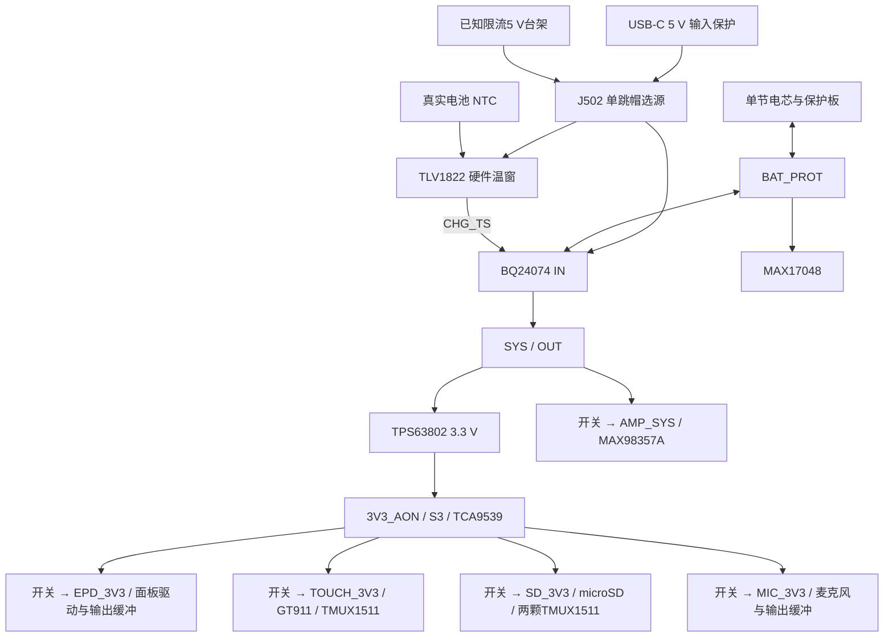

# 开发验证板电源设计规格（r0目标，r5约束）

> 2026-11-04更新：[当前设计假设](design-assumptions-2026-11-04.md)保留电池端≤1A预算及纯延长件按屏幕/触摸文档定义的决定。用户授权按Honeywell 175-103LAE-301 Rev.B候选曲线设计温控，并提高充电电流；当前采用[r5充电设计](charging-design-r5.md)，实际电池是否使用同料NTC尚未证实。

> [中顺芯官网核查](battery-zoncell-2026-11-04.md)提供系列4.2V、标准0.1C/快速0.2C、充电10–45°C和175/10kΩ NTC依据。r5采用约0.7A充电与独立硬件温窗，R108继续DNP、J105保持开放；实际曲线、热和上电验证安排在样机阶段，不阻塞制板设计。本次未采购或使能充电。

规格日期：2026-11-01，落图状态更新：2026-11-04。**当前为[KiCad原理图r5候选](../../../hardware/devboard-r0/README.md)，未冻结制造BOM、未上电验证。** 本文保留r0电源目标以及[r4条件闭合](closure-review-r4.md)的反馈、输入保护和电容约束，充电部分更新为r5；工程目标和计算不是器件保证值或样机成绩。电源域状态见 [power-domains.md](power-domains.md)，测量记录见 [power-budget.md](power-budget.md)，外设电气架构见[外设设计r2](peripheral-design-r2.md)。

## 本轮决定

用户已选ZON.CELL 755570、1S、标称3.7V、4000mAh、带保护与三线10kΩ NTC的电池商品，以及3525腔体8Ω/2W扬声器。**按1S/4.2V体系作为设计假设推进**；实际电池的CV/NTC匹配尚未实测确认，R108继续DNP。音频仍优先提示音、有声书和低功耗。继续使用N16R8、现有屏幕与通用FP24/FP6延长链路。[用户配件输入](../../../hardware/reference/user-selected-r4/selected-components.json)

本轮据此选择以下原理图方向：

| 功能 | 当前选择 | 原因与边界 |
| --- | --- | --- |
| 充电与系统电源路径 | **BQ24074**，约0.7A候选；TLV1822独立温窗 | 4.2 V固定电池电压，输入档位与充电使能独立，安全定时器可调；仍需电池、温控与热验证 |
| 主电源 | TPS63802，名义 3.3 V，默认自动省电模式 | AON 与四条 3.3 V 外设支路共用；功放另走 SYS |
| 电量计 | MAX17048，接保护后的电池端 | 电压可用于低电量策略；SOC 需电池模型和温度补偿，不能代替保护板 |
| 电源控制扩展 | **TCA9539，16-bit，带独立 RESET** | 8-bit TCA9534 缺复位且端口不够容纳充电控制与触摸隔离 |
| 外设负载开关 | TPS22918 作为便于调试的候选 | 可调上升时间和输出放电；不据此声称具备反灌阻断或可调过流保护 |
| 触摸信号隔离 | TMUX1511，四路覆盖 SDA/SCL/RESET/INT | 触摸掉电后 AON I²C 仍可工作；INT 保留双向选址能力 |
| 功放 | MAX98357A，由受控 SYS 供电 | 首版不加专用5V音频升压；采用用户所选8Ω扬声器，首轮输出≤0.5W作为测试预算，实际限幅/音量待验 |
| 日常关机 | 外设关闭、主控深睡，保留按键和 USB 插拔唤醒 | 没有运输锁存或零耗电关机；充电控制与用户界面开关分开 |

BQ24074保留为具有可调定时器和独立EN1/EN2的开发板候选。r5将R104/ISET改为1.27kΩ，并以R113=1.27kΩ设置ITERM；R105/TMR=68kΩ、R103/ILIM=1.62kΩ不变，替代r4历史约297mA且ITERM悬空的配置。BQ25185此前核对的Rev B快充定时器固定360min、切输入档位需重新检测设置，仍不作为默认。此决定不是采购批准，也未比较实时供应价格。[BQ24074，§7–9](https://www.ti.com/lit/ds/symlink/bq24074.pdf)、[BQ25185，§6–7/修订记录](https://www.ti.com/lit/ds/symlink/bq25185.pdf)

## 电源连接与测量边界

- `BAT_PROT` 是电池包保护后的端子。充电、系统放电、电量计均接此侧；不把板上地另接到保护前电芯负极。
- BQ24074的OUT在输入充足时名义4.4V、资料稳态最大4.5V；输入不足时电池可补峰，电池供电时随电池及路径压降变化。SYS不能按固定4.4V计算所有工况。C102/C201等SYS电容按5.0V资格检查留余量，实际瞬态仍须测量。
- EPD_3V3 只供参考电路的低压输入。面板升压节点与内部 VDD18 按 [面板资料](panel-reference.md)连接，不能接成普通 3.3 V 电源输出。
- 预留 BAT、SYS、主 3.3 V、EPD、TOUCH、SD、MIC、AMP 的独立可断开测流连接，测量短接件要标方向和额定电流。高速信号测试点尽量短。
- 外接 SYS/3.3 V 台架注入必须先断开上游；禁止两路稳压输出直接并联。TPS63802 在强制 PWM 工作时支持反向能流，EN 关断的负载隔离不能作为任意外部供电并联的依据。[TPS63802，§9.3.8/9.4](https://www.ti.com/lit/ds/symlink/tps63802.pdf)

## 首轮工程目标

以下是设计和台架验收的起点，尚未证明可达。改变目标必须在测试前记录理由与版本；电池和实际外设确认后，只能按其更严格条件收紧边界。

| 项目 | r0 目标 / 使用条件 |
| --- | --- |
| USB | 5 V 受电、USB 设备端；不请求更高 PD 电压，不供 USB Host |
| 电池台架扫描 | 保护后端子 3.0–4.2 V；3.0 V 为电源设计压力点，**不是批准电芯放电到该电压** |
| 主 3.3 V 稳态 | 3.3 V ±3%；各终端还须满足自身范围，特别复核触摸总成与裸芯片资料差异 |
| 主轨预留能力 | 从SYS台架源测试1.0A持续、1.5A/100ms脉冲；实物电池端采用总放电≤1A预算，不能把主轨台架目标用于批准电池负载组合 |
| 主轨瞬态 | 在上述台架负载范围内保持 3.135–3.465 V；如果终端允许范围更窄，使用更窄范围；无 MCU brownout/复位 |
| 软关机 P01 | 电池端 3.7 V、25±5°C、无 USB、无调试器、LED 关闭，稳定后 10 min 平均 ≤200 µA；目标未测 |
| 外设关轨 | 带输出放电的低压支路在 1 s 内降至 <0.2 V；不得靠被关断器件吸收跨域注入来达标；该目标不适用于 EPD 高压储能节点 |
| 音频 | 8Ω/2W扬声器商品；语音用途，首轮按输出≤0.5W预算，软件限幅尚待实现/测量；不承诺功放标题功率 |
| 充电 | 初装默认禁充；r5约0.7A/30mA终止/9.07h与硬件温窗为设计候选，样机验证匹配后才使能 |

当前实物电池首测环境为20–30°C，总放电预算≤1A且不额外放宽瞬态。采用主轨0.5A、音频电输出0.25W、SYS低端2.9V、两条转换路径各80%效率和其他50mA的分配例，估算约0.869A；实际峰值仍需台架测量，详见[当前设计假设](design-assumptions-2026-11-04.md)。

**r4历史压力算例仅保留为台架设计参考：** SYS最低2.9V、主稳压与功放效率各85%、主轨1A、音频输出0.5W及其他50mA，电池估算约1.592A；主轨增至1.5A时约2.261A。商品2A连续及未注明时长的3A脉冲声明不替代本阶段1A电池预算。实际效率、最低SYS、保护动作和同时峰值均待测，不能把TPS63802的“2A”标题当整板保证。历史计算见[r4电源边界](../../../hardware/devboard-r0/review-r4/power/power-bounds.json)。

## 充电、USB 输入与 NTC

### BQ24074 原理图接口

按 **BQ24074** 具体型号核对封装，不混用 BQ24075/79 的 SYSOFF 功能：

| 引脚 | 网络 / 处理 |
| --- | --- |
| IN13；OUT10/11 | USB保护后/已知台架经J502选到VIN_5V；OUT为SYS_RAW，再经R101到SYS，按原厂去耦 |
| BAT2/3；VSS8/散热焊盘 | BAT_PROT；公共地与散热铜，VSS 不能只依赖散热焊盘连接 |
| TS1 | `CHG_TS`由TLV1822两路开漏输出共同控制，TS以10kΩ接地；真实电池NTC接比较器温窗，不能绕过温窗而仅以固定电阻允许充电 |
| CE_N4 | 高禁止充电；SYS 上拉及 MOS 下拉构成 `CHARGE_ALLOW=1` 才允许充电；上电、IOX 复位与 MCU 高阻均默认禁止。上拉须计入内部约285 kΩ下拉，保证最坏条件下 VIH |
| EN1=6、EN2=5 | 各有外部下拉，默认 USB100；由 IOX 独立控制，留台架可断开配置位 |
| PGOOD_N7、CHG_N9 | 开漏，上拉到 AON，接 IOX；不直接替代 VBUS_PRESENT 或电池电流测量 |
| ISET16、ITERM15、TMR14、ILIM12 | R104=1.27kΩ、R113=1.27kΩ、R105=68kΩ、R103=1.62kΩ；均为1%、100ppm/K候选，ITERM不再悬空 |

输入模式始终按 **EN2、EN1** 顺序记为：`00=100 mA`、`01=500 mA`、`10=电阻限流`、`11=USB suspend/关闭输入路径`。普通00/01/10切档不需要重新开始充电，这不适用于CE翻转或11挂起。USB500 模式允许升档前必须已获得相应供电能力；仅有 CC 下拉和“VBUS 有电”不能证明大电流可用。首版无自动 CC 电流识别，高档仅供明确配置的台架电源验证。[BQ24074，表7-2/§9.3](https://www.ti.com/lit/ds/symlink/bq24074.pdf)、[Microchip USB-C 供电说明](https://developerhelp.microchip.com/xwiki/bin/view/applications/usb/power-delivery/)

当前原理图沿用r1选源接法：J502单跳帽1–2选USB、2–3选已知限流5 V台架，断电后换档。R221检测USB保护后的节点，位于选源之前；PTC跳脱可使VBUS指示失效，BENCH输入不会被误判为USB。PGOOD仍检测选中的充电器输入。PTC/TVS不是持续过压或精确限流器；整口电流、压降、USB挂起和无电池启动仍须测量。

r4的F501改用Bourns **MF-MSMF200/16X-2**，1812 Style2、最大高度1.60mm。目录Ihold在50°C为1.68A、60°C为1.48A。按下文输入温漂上界加5mA未测旁路分配，总预算 **1.08447A**，为60°C Ihold的73.27%，闭合原110型号的高温正常载流不匹配；短路动作、TVS配合、高温压降及线束温升仍未验证，默认100mA和USB供电授权规则不变。[独立电源复核](../../../hardware/devboard-r0/review-r4/audio_boost/independent-power-review.json)

USB 档位变化由单一电源服务执行，跨 `01↔10` 时先经 `00`并读回，防止两位非原子写导致误入其他状态；正常切档保持CE状态，不为切档反复重新启充。总输入预算还要包含BQ输入之外的VBUS检测/保护负载。挂起时执行`11`并检查整机输入电流，不能把`00`当作USB suspend。温度越界由硬件拉低TS暂停充电与计时，恢复后继续原计时进度，不能改为反复翻转CE。CE翻转/输入挂起等可能重启芯片安全计时，充电服务还须跨深睡保存会话时长与故障重试记录；记录/时间失效时不得自动清故障继续充电，不能靠USB抖动或反复重启延长充电。

**无电池、USB100 下的冷启动尚无保证。** 初次完整功能验证使用可补峰的合格电池，或上电前设置已知电源能力的台架档位；未知电脑 USB 口不得强制高档。启动最小模式关闭无线和全部外设；若不能稳定枚举，则无电池启动功能仍未通过，不能用反复重启代替修正。ROM 下载模式也纳入这一验证。

开发板还须有受控的耗尽恢复配置：断开主稳压EN的正常上拉并拉低EN，GPIO4的硬件下拉同时保证SYS功放支路关闭，EN1/EN2固定00；再以明确标注的维护跳线J105将CE_N拉低，允许硬件充电器恢复合格电池。J105初装保持开放，恢复后撤掉维护跳线再正常启动。此配置仍经过电池保护、TLV1822真实NTC温窗、ISET与定时器，不能绕过这些限制。只在充电网络已通过样机适配验证、且连接已知台架电源时使用。通过低电池/保护断开冷启动测试前，不承诺日常插USB可全自动恢复；生产版需消除此人工恢复依赖。

当前r5计算起点如下，不是启充或采购批准：

- `RISET=1.27kΩ/1%`名义约700.79mA；计入100ppm/K电阻的−40～85°C本体温漂及TI系数后为约0.61733–0.78054A，低于4Ah×0.2C=0.8A设计上限。实际恒流还受输入余量、DPPM与热限制影响。
- `RITERM=1.27kΩ/1%`与ISET标称相等，独立电阻误差仍须分别计算；USB500/ILIM下终止电流约21.77–38.76mA、典型30mA，低于0.01C=40mA；USB100约7.74–12.40mA、典型10mA。DPPM/VIN-DPM/热调节期间不能假定终止判据有效。
- `RILIM=1.62kΩ/1%`名义约0.994A；同样加入电阻温漂后约0.91084–1.07947A，另加5mA旁路预算即1.08447A。该档不等于充电电流，也不代表普通USB口可提供它。
- `RTMR=68kΩ`名义快充约9.07h，按上述电阻模型为约6.688–11.521h。4Ah÷0.70079A约5.71h，仅是理想容量比值；按最小设定电流约6.48h，已接近最短计时，加入CV尾段后不能保证充满。DPPM/VIN-DPM/热降流会按芯片规则放慢计时，仍保留未充满即超时停充的可能。
- TMR电阻允许范围**18–72kΩ**；不能因容量较大就增至72kΩ以上，也不能停用定时器或循环CE绕过超时。温度暂停通过TS保留计时进度。
- 输入限流最小值减充电设定最大值只余约130mA给系统与芯片；系统负载增大时DPPM会降低充电电流。高档仅用于能力已确认的电源，未知USB仍为100mA。
- 线性充电损耗初算用 `(VIN−SYS)×I_SYS + (VIN−VBAT)×I_CHG`。VIN=5V、VBAT=3V、SYS=4.3V、系统100mA及最大充电设定时约1.63W；5.25V输入、2.9V电池同类工况约1.93W。这些是散热设计压力算例，未含全部偏置损耗，也不是已能持续输出的结论；实际PCB铜、过孔、壳体与温升须验证。

以上BQ边界引用电气特性表的**TJ=0～125°C保证范围**；外部电阻按−40～85°C建模不赋予BQ负温度保证，也不扩大电池允许温区。计算包含初始电阻公差与100ppm/K温漂，未含老化、焊接漂移或测量误差。公式、来源及可复算输出见[r5电源计算](../../../hardware/devboard-r0/review-r5/power/calculate_bounds.py)和[边界结果](../../../hardware/devboard-r0/review-r5/power/charge-bounds.json)。原仅含初始±1%的1.07245A输入上界不再用于本轮PTC温漂预算。

**NTC匹配是实际启充前的验证项，不阻塞本阶段布局。** r5按用户授权采用[Honeywell 175-103LAE-301 Rev.B曲线](../../../hardware/reference/ntc175-2026-11-04/honeywell-175-103lae-301.pdf)：R25=10kΩ±3%、B25/85=3750K±3%；尚未证实电池使用同型号。BQ24074原厂103AT-2参考窗口为0–50°C，r5不直接使用该窗口或把真实电池NTC直连TS，而在第11页`CHARGE_TEMP`加入独立温窗：

- TLV1822DR直接由`VIN_5V`供电；真实`BAT_NTC`以47kΩ上拉，电池NTC另一端接规定公共地。
- `HOT_REF`以100kΩ/12kΩ分压，`COLD_REF`以100kΩ/33kΩ分压；上臂均接VIN_5V、下臂接地。
- 开漏输出1/7共享`CHG_TS`并连接BQ的TS；TS以10kΩ接地，`CHG_TS`向`BAT_NTC`和`COLD_REF`分别接330kΩ正反馈。TS固定电阻只是输出接口，不能替代真实NTC与比较器。
- VIN去耦100nF，NTC/HOT/COLD各10nF；5V标称模型冷暂停/恢复14.82/15.49°C、热暂停/恢复40.05/39.49°C。恢复点以输出低电平0.1V演示，不代表器件典型VOL。温窗全角模型与温度/供电、失调和输出低电平预算以[r5温控结果](../../../hardware/devboard-r0/review-r5/temperature/temperature-window-results.json)、[独立复核](../../../hardware/devboard-r0/review-r5/temperature/review.md)及[r5充电设计](charging-design-r5.md)为准，设计要求暂停边界不越出10–45°C；模型结果不等同原厂对全部供电/共模条件的保证。

温度越界由TS暂停充电，维护J105不会绕过温窗。NTC开路、短路、冷热边界、迟滞、供电建立与断电行为均须台架验证。当前没有已验证的MCU电池温度采样链路，也没有固件电池低温负载保护；硬件温窗并不补齐这些能力。[BQ24074，§9.3.6](https://www.ti.com/lit/ds/symlink/bq24074.pdf)

### 主稳压与电量计

TPS63802默认MODE低，EN保持硬件自启动；软件软关机不关闭主稳压器。r4反馈改为R201 **51.1kΩ / TNPW060351K1BEEA**、R202 **9.10kΩ / TNPW06039K10BEEA**，均0.1%、25ppm/K；0.47µH电感、10µF输入和22µF输出标称容量不变。电阻本体−40～85°C、0.1%初始公差、每颗0.1%老化预算及PWM反馈/输入偏流模型给出3.2494–3.3666V区间，符合3.3V±3%的计算目标；PFM纹波与动态仍需上板验证。精确3.3V处新增分压负载约49.34µA，须换算后计入P01。其内部UVLO不是锂电保护。[计算与独立复核](closure-review-r4.md)、[TPS63802，§8/10](https://www.ti.com/lit/ds/symlink/tps63802.pdf)

有效电感要求0.37–0.57µH；C201 **C3216X5R1C106K160AA**为10µF16V±10%1206，在5.0V资格包络下必须有效≥4µF；C202 **C3216X5R1C226M160AB**为22µF16V±20%1206，在3.6V包络下必须有效≥7µF。准确候选已经指定，联合偏压/温度/老化容量尚未证明；X5R本体不能超过85°C。BQ的C102/C103另按项目保守门槛有效≥4.7µF检查，不能把该规则写成BQ明确的偏压保证。详细门槛见[r4电容审查](closure-review-r4.md)。

MAX17048 的 VDD 同时测量电池，接 BAT_PROT，不接 SYS/3V3；地址0x36，I²C上拉在AON。默认自动hibernate，不在每次MCU重启时quick-start；处理STATUS.RI，在电量计真正复位后恢复配置。active约250 ms、hibernate约45 s更新电压，重负载前需取得新鲜测量，不能依靠它处理瞬态欠压。无电池、保护断开、越出其工作电压或读取失败时标无效；I²C ACK、BAT电压、PGOOD均不能单独证明电池存在，因为无电池时BAT电容仍可能供电。存在判据未闭合时SOC保持无效。MCU温度补偿数据通路尚未确定：首轮只评估室温误差，预留独立温度采集，不能在充电NTC节点随意加负载。保护断开后SDA/SCL掉电行为须验证，必要时增加隔离。[MAX17048，p2/6–10/13–16](https://www.analog.com/media/en/technical-documentation/data-sheets/MAX17048-MAX17049.pdf)

## 控制器、信号隔离与复位

完整分配见 [GPIO表](gpio-allocation.md)。GPIO42 改作 IOX_RESET_N，卡检测转 IOX P05；**GPIO2 改作 VBUS_PRESENT，GPIO44 改作音量/翻页+**，从而允许 USB 插拔唤醒。普通电源键仍为GPIO21，触摸INT为GPIO1。

TCA9539 采用A0/A1接地，7-bit地址0x74。RESET_N外部下拉；初始化先在复位期间处理主控输出，再释放复位，写安全输出锁存，最后设端口方向并读回。复位默认是全输入、输出锁存全1，不可先改方向。本设计P07经MOS映射为高有效CHARGE_ALLOW，所以全部控制输出的安全值为0。10 µs可作为IOX复位脉冲初值，外设完全放电需另外满足时间/残压条件。[TCA9539，§8.8/9.3/9.6](https://www.ti.com/lit/ds/symlink/tca9539.pdf)

不能保证所有ESP32软件/看门狗复位都立即释放GPIO。启动入口须处理遗留hold、先设置已知电平、再明确复位IOX；此操作可能中断崩溃前的SD写入，因此记为异常恢复，不冒充正常卸载。正常运行中的一次I²C错误不得立即触发IOX复位：先阻止新业务、停止音频/存储事务，尝试有界总线恢复，能够卸载后才断轨。[ESP-IDF GPIO hold](https://docs.espressif.com/projects/esp-idf/en/stable/esp32s3/api-reference/peripherals/gpio.html)

| 边界 | 上电准备 | 关断准备 / 硬件要求 |
| --- | --- | --- |
| TOUCH | TMUX四路先断开；轨稳定后设置RESET/INT，再接通信号并执行GT911完整选址复位 | 停访问、取消触摸唤醒、断四路，再关轨；TMUX由TOUCH供电、SEL外部下拉；两侧I²C上拉核算并联值 |
| EPD | 主控信号安全态、开轨、按面板流程复位；五路输出经EPD域缓冲 | 等刷新结束、发休眠、停止SPI，再关轨；CS默认上拉属于EPD域，BUSY经AON缓冲返回；掉电读低视为忙或无效 |
| SD | SD_IO_EN=0保持六线隔离，SD_EN开轨；等待经台架确认的稳定时间，再令SD_IO_EN=1并建立SDMMC；CMD/DAT0–3上拉在SD域 | 排空写入、关闭文件、卸载、停止SDMMC，再SD_IO_EN=0、SD_EN=0；卸载超时保持必要供电；卡检测是独立机械触点 |
| MIC/AMP | GPIO6保持静音，GPIO4开启两支供电和输出缓冲；稳定电源并建立零数据时钟，丢弃麦克风稳定阶段数据，再解除静音 | 音量渐降至零、GPIO6静音、停止I²S、GPIO4关闭缓冲和两条供电；不得只撤WS而继续BCLK；录音时功放持续shutdown |

触摸与SD的TMUX1511分别由各自受控域供电；SD新增IOX P13独立控制SD_IO_EN，P01仍只控制SD电源。掉电保护不等于整个供电过渡区间都已验证：信号推荐范围随VDD变化，必须测量爬升、残电和AON异常掉电时的漏电/隔离，也须核对I²C上升沿。TPS22918只负责供电开关，不替代信号隔离；CT、QOD电阻和电容按浪涌与掉电目标计算。具体边界见[外设设计r2](peripheral-design-r2.md)。[TMUX1511，§5/7](https://www.ti.com/lit/ds/symlink/tmux1511.pdf)、[TPS22918，§6/8](https://www.ti.com/lit/ds/symlink/tps22918.pdf)

R215/TOUCH_IO_EN、R223/SD_IO_EN、R306/AMP_SHUTDOWN、R416/AUDIO_EN均改为10k下拉，按多路输入最坏漏电核算默认低电平。每个控制为3.3 V高时，名义电阻电流约330µA；这是活动场景电流，不能直接加作所有控制关闭时的P01静态电流。两颗AON返回缓冲的静态电流和各域关断漏电另行纳入整机测量。

MAX98357A工作范围2.5–5.5 V，与受控SYS路径匹配；低电量最大音量须降额。r2的GAIN_SLOT接AMP_SYS，采用6dB候选；SD_MODE经2k串阻、100k下拉，驱动高选择左声道，播放数据须软件混音/重采样到左槽。扬声器为差分输出，两线都不接地。MIC/AMP共用GPIO4并不等于独立使能；首轮录音功耗包含已供电但shutdown的功放，MIC与AMP独立衰减、拆测流电阻或异常掉电时的注入/爆音仍须测量。[MAX98357A，p4/17/28](https://www.analog.com/media/en/technical-documentation/data-sheets/MAX98357A-MAX98357B.pdf)

麦克风采用PUI DMM-4026-B-I2S-R候选，首测48kHz、双32-bit槽、64fs=3.072MHz；旧16kHz配置不直接适用。四路输出缓冲锁定有Ioff规格的Nexperia 74LVC125APW,118，四路/OE由带Ioff的TI SN74LVC1G14施密特反相器驱动；不能用另一厂家的同名125器件替代掉电保证。r4已建立7焊盘、Ø0.60±0.05mm PCB声孔与GND环的专用封装候选，贴装、声道、生命周期及供货仍待确认，细节见[r4闭合审查](closure-review-r4.md)。

## 运行、休眠与关机时序

### 开机

1. 保持充电禁止、音频关闭和静音；处理GPIO hold，建立安全引脚状态，再主动复位IOX。
2. 初始化AON I²C，识别0x74和可用电量计，写控制安全掩码/方向并读回。未知板型不得驱动候选引脚。
3. 读取VBUS、PGOOD、CHG和电池有效性；仅在样机电池配置与温控验证通过、充电会话无锁定故障时允许充电。因IOX复位会使CE回到禁止，异常重启后不得无条件再次启充：需恢复持久故障/时长记录，记录不可信或已超时则保持禁充并进入维护诊断。输入能力未确认保持100 mA。
4. 按实际资源需求逐个启动TOUCH、SD、EPD或音频；每个驱动有自己的就绪条件和超时，禁止统一固定延时后假定全部成功。

### 正常软关机

1. 停止接受新业务，等待或取消后台任务；音频淡出并静音，存储排空并卸载，屏幕完成刷新并休眠。
2. 保存必须的状态，取消触摸唤醒，隔离跨域信号，关所有外设轨；读回开关命令，等待规定残压/放电时间。
3. 任何业务准备失败则回滚已暂停的服务，保留必要电源并报告原因。低压已不足以完成保存时走异常掉电路径，不能承诺文件完整。
4. 无USB时禁充并将IOX_RESET_N拉低；配置正常电源键及VBUS插入唤醒，MCU深睡。默认软关机不定时联网、不靠触摸唤醒。

### 关机状态的 USB 服务

- VBUS检测接RTC GPIO2，采用AON侧上拉的开漏、低有效`VBUS_SENSE_N`，或等价具掉电隔离的接口；不能直接5 V分压后就忽略掉电注入。须验证USB在而AON=0的维护恢复工况。去抖后再次检查实际电平和PGOOD。
- 插入只唤醒电源服务，全部外设继续关闭。未知来源/电脑USB保持USB状态服务运行，不能仅凭VBUS就进入会失去USB状态处理的深睡；必须响应配置、挂起和恢复。只有已明确为独立适配器的台架配置才进入下面的充电深睡，首轮采用100 mA保守输入档。500 mA/可编程档仅在来源授权持续有效时使用。
- 充电睡眠保持IOX释放、充电允许和明确的EN1/EN2状态，GPIO42需经过数字GPIO hold与deep-sleep hold配置；不能把RESET拉低后还假设充电使能保留。拔出唤醒后禁充、复位IOX，再回无USB软关机。
- 电源键可用EXT0低电平；VBUS用EXT1监视与当前稳定电平相反的电平，区分插入/拔出。入睡前重新采样，按键须已释放，否则可能立即重复唤醒。唤醒时先配好输出再解除hold；具体IDF调用与波形另验。
- EXT1是电平唤醒，设置后须再采样避免睡眠竞态；EXT0保留RTC外设的功耗也计入P01。若VBUS已存在但PGOOD暂未有效，每轮重试次数有界，失败后留在低频电源维护/轻睡状态，直到输入有效或拔出；不能只等不会再出现的插入沿，也不启动联网任务。
- 默认100 mA充电会较慢，不能由此估算完整充电时长。若最终要求关机快充，新增CC/充电口能力识别后再修改此契约。

阅读待机可保留触摸域和INT唤醒，定时更新也有独立睡眠配置；这两种模式不叫用户软关机。深睡恢复从启动流程重建业务，不承诺RAM会话保持。

## 原理图拆分与冻结门槛

原理图包含`POWER_INPUT_CHARGER`、`POWER_3V3_CONTROL`、`MCU_CORE`、`USB_INPUT`、`POWER_DOMAINS`、`TOUCH_ISOLATION`、`EPD_DISPLAY`、`STORAGE_SD`、`AUDIO`及新增`CHARGE_TEMP`。USB/台架通过J502单跳帽选择，五路负载开关、触摸/SD信号隔离、EPD升压/FPC和音频电路已跨页连通。当前为r5候选，封装与装配范围以工程README为准；C501/C502调谐DNP仍留空MPN，这不代表制造BOM放行。

落图细化：CE默认禁充上拉接测流前的`SYS_RAW`；反馈/COUT留在测流前的`3V3_REG`；`CHG_ARM`连接默认DNP；主稳压维护选择器开路默认关闭。VBUS开漏检测采用AO3400A，输入10k/栅极47k下拉，实际释放时间列入H05。原理图各位号与验证范围见工程README。

| 设计假设与样机验证输入 | 当前状态 / 影响 |
| --- | --- |
| 电池容量、保护板阈值、连续/脉冲电流、连接器和极性 | 已选4000mAh；当前采用电池总放电≤1A预算，保护/线束/极性留样机检查，不引用未定义的脉冲余量 |
| 电芯充电温窗、NTC料号/R–T/公差 | Honeywell候选曲线与官网系列10–45°C已用于r5硬件温窗；与实物匹配尚待验证，R108继续DNP、J105开放 |
| 扬声器阻抗、额定功率、声腔/音量 | 已选3525腔体8Ω/2W商品；首轮输出≤0.5W为预算，真实功率与声学待验 |
| 开关/电感/采样电阻/电容/MOS料号及封装 | 已指定候选；R602和Q601原厂land闭合，实际偏压、饱和、电流/端温、装配与采购核对仍保留 |
| 屏幕/触摸FPC、USB、microSD、扬声器和电池连接器 | 通用FP24/FP6按纯延长件、以屏幕/触摸文档定义，转接件额外资料不再阻塞布局；开发板线束用1751248端子过渡，极性/线径/操作空间留装配检查 |
| PUI麦克风专用7焊盘封装、声孔及供货 | Ø0.60mm PCB声孔、铜环与焊膏候选已建立；贴装/声道与供货待核，不沿用旧6脚封装 |
| 无电池USB启动、掉电总线隔离、电池存在判据、温度采集/RCOMP补偿 | 明确的验证项/接口待闭合，不视作已实现 |

## 检查记录

- 规格阶段8份原厂PDF已核对，落图补充AO3400A，共9份；来源、字节数及SHA-256已归档。
- GPIO表27个业务GPIO互不重复，未占用USB、BOOT、避用绑带脚或N16R8内存脚；IOX端口与I²C地址已交叉核对。
- 电源规格r0整理阶段，11份相关文档的本地链接、代码围栏和空白格式检查通过。
- 独立复核已修正：CE翻转重置充电计时、AON关闭时VBUS倒灌、PGOOD延迟恢复、电池存在判据与电量计数据新鲜度。

r4统计与机器检查保留在[历史条件闭合审查](closure-review-r4.md)，r5充电变更及本轮验证入口见[r5充电设计](charging-design-r5.md)和[工程README](../../../hardware/devboard-r0/README.md)。历史ERC/网表结果不能代替本轮变更检查。下一步可推进开发板布局、DRC与制造检查，电容有效容量继续按原厂资料核对；实际NTC匹配、线束、充电/温升、USB、功耗和文件完整性安排在样机验证，不再以索取纯延长件资料为布局前置条件。原厂PDF与版本哈希见[电源资料索引](../../../hardware/reference/power/README.md)及[外设资料归档](../../../hardware/reference/peripherals/README.md)。
