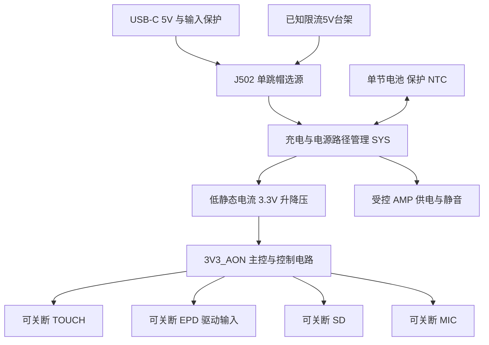

# 电源域与工作状态表

状态：新板电源架构候选。2026-11-02推进至[十页原理图r4](../../../hardware/devboard-r0/README.md)，五路TPS22918、触摸/SD隔离及屏幕/音频缓冲架构不变；[r4条件闭合](closure-review-r4.md)补充候选封装与额定预算，制造BOM和电气验证尚未冻结。参见[电源设计规格](power-design-spec.md)、[GPIO分配](gpio-allocation.md)和[测量预算](power-budget.md)。

## 供电结构

用户已选择提示音/有声书、功耗优先，以及3525腔体8Ω/2W扬声器。AMP仍采用受控SYS路径，不加专用5V升压；首轮音频输出≤0.5W只是设计测试预算，低电量限幅、功耗和噪声仍须验收。主控3.3V轨预算与功放SYS预算分别计算。

## 电源域定义

| 域 | 所含器件 | 控制归属 | 关断前条件 |
| --- | --- | --- | --- |
| BAT/SYS | 电池保护、充电路径、电量计必要部分 | 硬件管理；系统只读取/配置允许的状态 | 首版不由 MCU 任意切断自身供电 |
| 3V3_AON | MCU/模组内存、GPIO 扩展器、必要的检测电路、可选 RTC | 主稳压器 | 深睡时仍有该轨；常供电部分进入各自低功耗状态 |
| TOUCH | GT911 与其信号支路 | 平台电源服务，IOX P02供电/P10信号隔离 | 停触摸、取消触摸唤醒、隔离SDA/SCL/INT/RESET后断电 |
| EPD | 屏幕驱动/升压输入，具体节点按面板参考电路 | 平台电源服务，通过 IOX P00 | 刷新完成、面板休眠、SPI 无在途传输，再处理 I/O |
| SD | microSD、相关域内上拉 | 存储服务准备，IOX P01供电、P13信号隔离 | 禁止新文件操作，排空写入、关闭文件、卸载、停止总线，P13隔离后才P01断轨；正常关机超时不得断轨 |
| MIC | 数字麦克风低噪声供电 | 音频会话，GPIO4 所控制的音频使能路径 | 停止采集并保存需要的数据 |
| AMP | I²S 功放与扬声器 | 音频会话；GPIO4 供电、GPIO6 静音 | 先静音、停止输出，再关供电；顺序和延时通过测试确定 |

MIC 与 AMP 可由同一 AUDIO_EN 控制两条供电支路。录音时通过独立 AMP_SHUTDOWN 关闭功放输出；如果最终待机预算要求进一步降低录音功耗，再独立划分两路使能，不能在首版文档中声称已经实现。

## 状态矩阵

`开` 表示轨有效；`关` 表示隔离/掉电；`按需` 必须有资源持有者；`静音` 不等同于轨掉电。

| 系统场景 | AON | TOUCH | EPD | SD | MIC | AMP | Wi-Fi / MCU 行为 |
| --- | --- | --- | --- | --- | --- | --- | --- |
| 开机恢复 | 开 | 初始化后按需 | 初始化后按需 | 按需挂载 | 关 | 关且静音 | 先建立控制与板型，不因 MCU 复位假定其他域也复位 |
| 静态阅读、触摸唤醒 | 开 | 开，验证其待机模式 | 面板进入休眠后按策略关轨 | 无文件使用者且卸载后可关 | 关 | 关 | Wi-Fi 按任务需求；MCU 可进入允许的省电状态 |
| 翻页/灰阶刷新 | 开 | 开 | 开 | 按字体/书籍读取需求 | 按其他会话 | 按其他会话 | 刷新持有 EPD 资源与对应睡眠约束 |
| 本地音频播放 | 开 | 按交互需求 | 仅显示变化时开 | 开，播放期间保持 | 音频域实现决定 | 开 | I²S 活跃时不能进入破坏采样时钟的睡眠状态 |
| 网络音频播放 | 开 | 按需 | 按需 | 若无缓存/文件需求可关 | 音频域实现决定 | 开 | 网络与音频会话共同约束睡眠 |
| 录音到 SD | 开 | 按需 | 按需 | 开 | 开 | 静音/关断输出 | 记录会话持有音频与存储资源 |
| 文件上传/下载 | 开 | 按需 | 按需 | 写 SD 时开 | 按其他会话 | 按其他会话 | 网络传输和写入完成前不能直接切断资源 |
| 定时联网更新 | 开 | 按唤醒模式 | 有画面变化时开 | 按需 | 关 | 关 | 合并联网窗口，完成后再走休眠协商 |
| 深睡软关机，无USB | 开、器件进入低功耗 | 关 | 关 | 关 | 关 | 关 | 正常电源键GPIO21 / VBUS插入GPIO2唤醒；默认不定时联网 |
| 关机后的USB电源服务 | 开 | 关 | 关 | 关 | 关 | 关 | 只处理供电与充电；未知来源/电脑USB需继续履行USB状态处理；独立适配器台架配置才允许充电深睡 |
| 充电并使用 | 同正在执行的场景 | 同左 | 同左 | 同左 | 同左 | 同左 | USB 插入不代表所有外设必须常开 |

“保持屏幕图像”“面板休眠”“MCU 浅睡”“MCU 深睡”是四个独立状态。深睡恢复按重新启动处理；不承诺保留 RAM 中的应用会话。是否允许深睡触摸唤醒是可配置的独立模式，需保持触摸轨和验证 INT 电平，不属于上表软关机的默认行为。

## 软硬件契约

1. 外设活动通过带 owner 的资源/睡眠约束登记。禁止页面直接操作电源引脚；禁止仅根据“屏幕多久没点”决定整机睡眠。
2. 休眠准备先阻止冲突的新任务，再按依赖顺序排空必要 I/O、保存状态、等待刷新完成。任何准备失败都撤销已完成的暂停步骤，回到可运行状态。
3. 软件只在电源开关命令成功并满足稳定条件后，将域状态标为有效；I²C 写失败、面板 BUSY 超时或 SD 卸载失败都不能伪装为成功。
4. 负载开关靠外部电阻在冷上电/IOX复位期间默认关闭。GT911四线使用TMUX1511隔离；SD/EPD的总线、电源域上拉与保护器件逐条核对倒灌。
5. 触摸地址选择、SD 上电初始化、EPD 唤醒和音频静音时序分别由对应驱动执行。统一电源服务只协调域，不能用一个通用固定延时替代器件时序。
6. TCA9539 RESET由GPIO42独立控制，启动主动复位并重建控制状态。软件/看门狗复位与hold不保证立即释放GPIO，需分别验证；正常I²C错误不直接触发会中断SD写入的硬复位。
7. 无USB软关机保持IOX复位低；充电深睡需保持复位高与控制输出，不能混用。CE_N在SYS侧默认禁充，EN1/EN2默认100 mA；USB状态与耗尽恢复规则见r0规格。

ESP-IDF 的电源管理锁可限制自动省电行为，但不能代替板级负载开关与文件生命周期管理。[电源管理说明](https://docs.espressif.com/projects/esp-idf/en/stable/esp32s3/api-reference/system/power_management.html)

## 电源键与真正断电

正常电源键直接接RTC GPIO21，VBUS检测接RTC GPIO2；BOOT0和EN保留维护用途。首版长按关机定义为保存状态、停止业务、关闭外设后进入相应低功耗状态；电脑USB存在时还要处理USB挂起/恢复。BQ24074没有SYSOFF，不承担整机断电。运输锁存需另加硬件方案，本设计不声称已实现零耗电关机。
