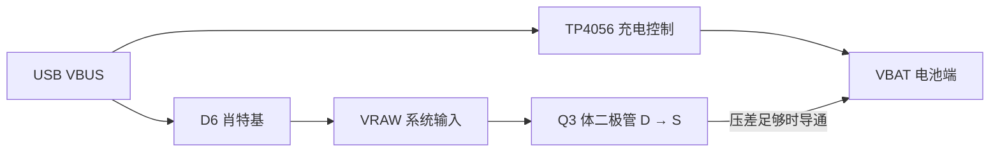

# 旧板六页静态电路审查

日期：2026-11-01。第一轮审查已完成，输出为保留、修改和待验证清单；本次没有修改旧电路、固件或板级引脚，也没有开始新版原理图绘制。

**首要结论：归档 POWER 页的 Q3 源漏连接形成一条可能绕过充电芯片的电池回灌路径，应作为新版设计前必须解决的问题。** 同时确认 BOOT 电容、GT911 高地址复位、外设关断契约和音频接口说明存在需要修改或补全的项目。显示接口与升压参考拓扑、主控资源选择、USB 基本连接和 SD 外部上拉有可保留的依据。

用户已澄清：当前固件运行于核心板，相关 GPIO 被 LED 占用，所以 SD 使用调整后的单线配置。**归档 PCB、当前核心板和新版开发验证板是三个不同硬件目标。** 下文电路风险限定于归档设计，不表示当前实物具备相同接线；SD 配置差异不列为 PCB 错误。

## 审查范围与证据

| 项目 | 本轮覆盖 |
| --- | --- |
| 设计输入 | `ProPrj_ESPaperPlay_2026-11-01.epro2`，SHA-256 `aa9540b138b95a9e4e70a56337f4366901f3e5233e9a12d55d852e55732ef614` |
| 原理图 | MCU、EPD、TOUCH、SD、POWER、AUDIO 六个有效图页；排除五个已删除历史图页 |
| 视觉检查 | 归档中六张完整页面预览，与最终器件属性和关键 PCB 引脚网络交叉核对 |
| 结构化检查 | 103 个原理图器件位号与 103 个 PCB 元件记录对应；385 条 PAD_NET 归并为 352 个唯一器件引脚网络 |
| 固件接口 | 29 项 GPIO 宏对照，27 项一致、2 项 SD 差异已按用户说明归为板卡适配；另核对 USB 固定引脚、复位及断电流程 |
| 外部依据 | 实际制造商的数据手册、乐鑫设计指南、屏幕总成及 GT911 资料；同名替代器件未直接套用另一厂家的保证值 |
| 未覆盖 | 原软件 ERC/DRC、全部连线几何/铺铜验收、实际装配版本、器件真伪与供货、示波器波形、功耗、温升、EMI/ESD、长时间运行 |

资料入口：[旧工程与哈希](../legacy-project.md)、[结构化证据](../../../../hardware/reference/legacy/review-evidence.json)、[屏幕原厂资料](../panel-reference.md)。原始归档保持不变；预览缓存和 PCB 网络元数据都不能代替实板检查。

## 优先处理清单

这里的优先级是推进新版设计的顺序，不是实测故障次数。P0 表示需先消除的供电风险，P1 表示进入原理图冻结/功能移植前处理，P2 表示在选型、布局和验证阶段闭合。

| 优先级 | 项目 | 已确认依据与影响 | 处理 |
| --- | --- | --- | --- |
| **P0** | Q3 负载共享的源漏方向 | AO3401A pin2/S=VBAT，pin3/D=VRAW；体二极管方向为 VRAW→VBAT。压差足够时，USB 可经 D6、Q3 体二极管进入电池，绕过 TP4056 | 重新设计系统电源路径；核对准确封装/管脚。条件、电流和现有实板是否相同见电源分项 |
| P1 | BOOT 上的 1µF 电容 | R28=10kΩ、C36=1µF 接 GPIO0；与乐鑫避免该脚大电容的建议不符 | 调整 BOOT 去抖，独立保留 EN 时序；测冷上电、复位与下载 |
| P1 | 关断外设时缺少完整访问/IO 收尾 | 共享轨关闭前未形成 SD 卸载、触摸任务停止、总线及 GPIO 安全状态的完整屏障 | 在平台服务层定义停止访问、完成事务、睡眠/卸载、隔离、断电的顺序及失败处理 |
| P1 | GT911 高地址复位阶段缺失 | `gt911_hw_reset(1)` 在选择高地址后直接转输入，缺少原厂时序中的 INT 拉低保持阶段 | 修正两种地址的时序并测波形；不据此声称默认地址已失效 |
| P1 | 电池充电与保护条件未闭合 | TEMP 接地关闭温度检测；设置约1A充电，电池规格、保护、热和输入供电能力尚未验收 | 新版纳入 NTC、输入/充电电流约束和实际电池规格；不能将“有充电芯片”视为完整电池管理 |
| P1 | 主供电及音频供电为降压 | TPS62840、TLV62569 在输入接近输出时不能保证维持标称3.3V | 明确最低电池电压和负载，按新版升降压方向及音频要求重新核算 |
| P1 | 外设轨稳态关断不等于上电全程关断 | Q2 栅极 RC、复位 GPIO 和跨域信号可能产生上电暂态/断电倒灌 | 定义硬件默认状态，测启动、复位、关轨和残压 |
| P2 | 音频硬件/接口说明不一致 | SD_MODE 高电平实际选左槽；MIC_DOUT 无建议外下拉；采样率接口没有限制到器件支持集合 | 固定声道策略、输入约束及三态处理；按真实负载验收输出功率 |
| P2 | I²C 与 EPD 替代料裕量 | 10kΩ 上拉搭配400kHz需测上升沿；Q1/二极管/电感须按实际厂商核对 | 核对电容负载、波形和器件曲线，保留拓扑不等于批准具体BOM |
| P2 | 连接器、器件生命周期与注释 | FPC信号触点与固定焊脚混计；H2间距注释不符；ICS-43434原厂EOL | 统一器件料号/机械图/注释，新麦克风另选并重新审查 |

### Q3 路径为何需要先处理

归档的正常充电路径与额外的条件性路径如下：

这里确认了设计中的路径及其方向，**没有测出电流，也没有证据证明已经发生过充**。如果存在按此归档制造且未改线的实板，核对 Q3 前应避免同时连接真实电池和 USB；验证先用断电管脚/二极管检查和受控限流台架，不以真实电池试错。当前核心板是否使用这一路电源尚未确认。详细位号、原始行号及原厂依据见 [POWER 审查](legacy-power.md)。

## 可保留的设计基础

| 功能 | 保留范围 | 限制 |
| --- | --- | --- |
| 主控 | N16R8 模组、禁用存储器占用脚、EN复位、原生USB下载 | 不代表现有 GPIO 表已经适用于所有板卡 |
| EPD | 24触点接口脚序、VDD18独立去耦、BUSY低有效、升压参考拓扑 | 替代料、有效电容、峰值和布线仍需验证 |
| 触摸 | 六触点接口、独立RESET/INT、上拉归属触摸电源轨 | 调整复位流程、GPIO选择和断电隔离 |
| SD | 四线布线目标、CMD/DAT0–3五路外部上拉、卡座去耦 | 新增卡检测；核心板单线与新板四线各有独立配置 |
| USB | 两路独立CC下拉、正反插数据汇合、双通道ESD连接 | 预留匹配调试位置，输入电流/浪涌/ESD仍待验收 |
| 音频 | 独立开关域、提前静音、共享I²S时钟、差分扬声器连接 | 电压余量、麦克风替换、声道和采样率契约须重审 |

## 分项报告

- [MCU、USB 与 SD](legacy-mcu-usb-sd.md)：启动、物理脚号、板卡适配、USB/SD连接、卡检测与关机收尾。
- [POWER](legacy-power.md)：回灌路径、充电/保护、主稳压、PMOS开关、ADC与状态检测。
- [EPD 与 TOUCH](legacy-display-touch.md)：屏幕参考电路、FPC、触摸时序、总线及掉电边界。
- [AUDIO](legacy-audio.md)：供电、录放音接口、声道、采样率、器件与连接器。

## 下一阶段的设计输入

本轮输出可用于制定开发验证板规格，但不直接作为制造依据。先处理 Q3 所揭示的电源路径问题，再确定电池/输入电流与热预算、各域关断与信号隔离契约、板卡配置边界和需要实测的指标；之后绘制新版分模块原理图。其余器件仍维持候选状态。

后续实测记录至少包含供电方式、板卡版本、装配料号、电池/负载、温度、仪表、波形与通过标准。未测数据继续留空，不用规格典型值填充整板功耗结果。
