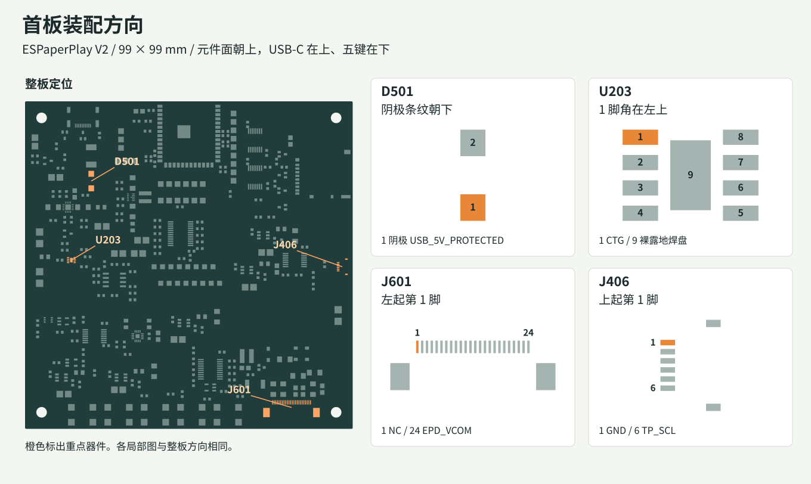

# 99 mm 首板装配复核

将板放成**元件面朝上、USB-C 在上、五个按键在下**。以下方向均按此视角。按原生原理图、PCB 网表、布线焊盘快照对读，局部图的焊盘边界另取自实际顶铜 CAM。四个器件共 45 个物理焊盘，网络与脚号对应一致。



| 器件 | 放置与核对 |
|---|---|
| **D501** · 安邦 SMAJ6.0A · C435519 | 将本体阴极条纹朝板下缘，对准下方的 1 脚 `USB_5V_PROTECTED`。上方 2 脚为阳极，接 GND。断电时可从 1 脚核对到 F501.2 或 J502.1。所购单向型号的本体极性标记见[安邦原厂规格](https://www.anbonsemi.com/file/PDF/SMAJ6.0A.pdf)。 |
| **U203** · MAX17048G+T10 · C2682616 | 从元件顶面看，将封装 1 脚标记朝左上。左侧自上而下为 1–4，右侧自下而上为 5–8。1 脚 CTG 接 GND，2、3 脚接 BAT_PROT，中心裸露焊盘 9 接 GND。印膏前在放大设备下确认方向，装上后顶部标记仍可复核。见[原厂数据手册](https://www.analog.com/media/en/technical-documentation/data-sheets/MAX17048-MAX17049.pdf)。 |
| **J601** · HOAUC HYCW3D-05FPC24-200B · C53436608 | 24 个细焊盘从左至右为 1–24，两个较宽的 GND 固定脚靠板下缘。1 脚为 NC，可用 2 脚至 R601.1（GDR）和 24 脚至 C610.1（VCOM）识别两端。焊接时使整排焊尾及两个固定脚同时落盘。见[华宇创原厂图](https://datasheet.lcsc.com/datasheet/pdf/56a886dce77cc08fa7b5dcd104301290.pdf?productCode=C53436608)。 |
| **J406** · LAILAN LAIL-FPC-CDX01-6P0.5-GW · C55172961 | 6 个细焊盘从上至下为 GND、TOUCH_3V3、RESET、INT、SDA、SCL，两个固定脚靠板右缘。可核对 2 脚至 J403.1、6 脚至 R418.2。该座为双侧触点款。见[莱联原厂图](https://datasheet.lcsc.com/datasheet/pdf/17379face50f319b31662f0dda9f609b.pdf?productCode=C55172961)。 |

两根 0.5 mm 延长线按屏幕和触摸资料确认两端的 1 脚。断开 USB 和电池，先对裸延长链逐线测通断、检查相邻线无短接，再插到板上核对电源、地及两端信号。板上部分地脚、电源脚本来就同网。保留屏幕端的方向标记，供第二块板装配复用。

## 首批无框钢网

5 块 PCB，先焊 2 块。首板手工印膏采用[专用顶层锡膏 Gerber](native99-first-two-top-paste-review.GTP)，配合同版板框定位。原生通用 GTP 在手焊的 FPC、USB-C 和 microSD 接口以及三个空贴器件的位置带有开口。专用层去掉 J406 的 8 个、J501 的 12 个、J601 的 26 个、J701 的 14 个，以及 C501、C502、R108 合计 6 个开口。所有手焊接口、排针和空贴位与剩余膏窗的重叠面积为零。

通用层还有一对开口交叠及三处钢桥偏窄。专用层对下表中 **5 个无源器件**的两端均采用同形、等面积、对准焊盘中心的矩形膏窗。终版共 633 个开口，其中 623 个保持原始几何，10 个按表调整。

| 相邻器件 | 通用层实际钢桥 | 首板专用钢网钢桥 |
|---|---:|---:|
| R705 / U704 | 交叠 0.005535 mm² | 0.15667 mm |
| R215 / R226 | 0.01003 mm | 0.24330 mm |
| C705 / U706 | 0.04987 mm | 0.15487 mm |
| C703 / U701 | 0.04988 mm | 0.15488 mm |

修改的器件是 R705、R215、R226、C705、C703。导出后重读实际 Gerber。全板最窄钢桥为 U802 中央窗间的 **0.120 mm**；跨器件最窄钢桥为 **0.15487 mm**。按 0.10 mm 钢片计算，全板最小开口面积比为 0.882。U101、U203、U301、U802、U803 的原生特殊膏窗均已逐个核对。钢网供应商需确认能保留原尺寸和最窄钢桥。几何结果与开口调整记录见[钢网报告](stencil-review.json)。

用胶带作铰链，先空对位再试印。放大检查 U101 的热孔与窗边，按局部每轴 ±0.03 mm 对位和 ±0.02 mm 钢网边缘公差复核。回流后再手焊接口、排针和按键，检查 J501 细脚、两个 FPC 座和 microSD 焊点。首板 J105 装排针并保持开路，R108 留空，充电默认禁用。

参考输入为[原生 PCB 网表](../pcb-routing/native-pcb.enet)、[原生原理图网表](../native-schematic.enet)及[顶层焊盘和锡膏复核](../pcb-routing/verification-run/smd-paste.json)。钢网和方向图用于打样前审查，锡膏转移、对位和回流情况待实板记录。

## 丝印修订后的复核

这张方向图和专用钢网基于布线版建立。丝印修订后导出的 CAM `ea5a5bd3…` 中，顶铜 3,472 个图元、原生顶层锡膏 699 个图元的物理几何、绘制顺序和极性均与布线版一致。236 个器件的放置与焊盘状态一致。已对新版原稿重新应用孔口保留、删除和调整清单，逐个比对专用钢网全部 633 个开口。报告保留两个版本各自的原始文件哈希。

从仓库根目录复核当前工程，使用工程验证环境中的 Gerbonara 1.6.2 和 Shapely 2.x。

```sh
native=hardware/devboard-99/easyeda-native
python3 "$native/audit/assembly-review/check-assembly.py" \
  --cam "$native/audit/pcb-routing/NOT-FOR-MANUFACTURE-routed-cam.zip" \
  --source "$native/source/PCB-layout.epcb" \
  --state "$native/audit/pcb-routing/final-routed-state.json" \
  --archive "$native/ESPaperPlay-99-Native-WIP.epro2"
```
