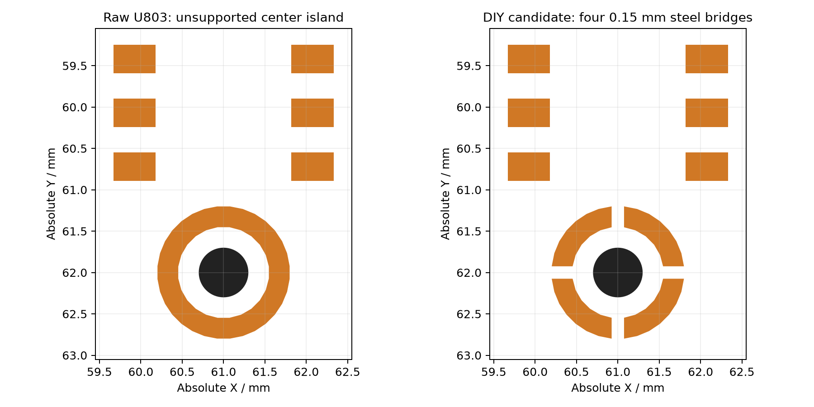

# r9 阻焊与 DIY 钢网审查

结论：已生成独立钢网工程候选；**0.10 mm 钢片、U803 四条 0.15 mm 支撑桥尚需试印与实际回流验证**。正式 r8 PCB、封装库、电路及 BOM 未修改。加工目录只有修正后的正面焊膏 Gerber，原生焊膏、派生 PCB 和比较文件留在 build 中；禁止将原生 F.Paste 直接作为本次钢网。

审查源：`hardware/devboard-r0/ESPaperPlay_Devboard.kicad_pcb`，SHA-256 `1a4556d866cc1352a2c45b674c94d2f233edf28c3e003bd96c8f6caf1e630681`；KiCad 10.0.8。详见同目录 `stencil-audit.json` 的逐开窗面积/周长/面积比、逐孔暴露率、84 项派生操作和原厂资料索引。

## 实际修正与装配划分

- 六个 DNP 位置 C501/C502/J301/J302/J303/R108 均不印膏。原生输出仍含其中三个 SMD 位 C501/C502/R108 的共 6 个开窗；三个 DNP 排针原本无 paste。
- 按用户选择，J501 USB、J701 microSD、J601 屏幕 FPC、J406 触摸 FPC 全部不印膏，后续手焊；排针、接线端子等 THT 同样不印膏。原生 J501 的 4 个 PTH 外壳槽孔原来带 paste，候选已消除。细脚接口仍需细尖/合适刀头、放大检查、控量助焊剂与吸锡带；尤其 USB 的靠壳焊点应确认烙铁可达后再固定外壳。若以后改成回流，必须重建接口钢网版本，不能手工随意补孔。
- U301 保留 40 个外围引脚印膏，取消中央 EPAD 的 9 个窗口，铜、12 个孔、接地保持原样。Espressif v1.8 PDF p.41 允许该模组 EPAD 不焊；代价是热路径不同，应验证持续 Wi-Fi/CPU/PSRAM 负载下温升及稳定性。这不适用于 U101/U201/U203/U802 的地/热焊盘。
- U803 原始闭合环在普通激光钢网上会留下悬空中心钢片。Gerber 内用于表达孔洞的零宽折返不是实体支撑桥。候选仅分割 paste 为四段，保持原铜环与 0.60 mm NPTH；四条桥宽 0.15 mm 属工程建议，不是 PUI 指定尺寸。回流后应形成连续声学密封，必须验证声孔无锡/助焊剂污染和漏声。



原始正面焊膏：**716 个绘制对象，712 个几何独立开窗，210 个位号**。候选：**636 个对象/开窗，203 个位号**；两版背面焊膏均为空。原始 USB 有共用焊盘的重叠绘制，统计已按实际几何合并，未重复计面积。

## 焊膏覆盖和厚度

表中面积来自实际 Gerber 与铜焊盘相交；圆角/原生自定义多边形会使数值与标注矩形面积略有差别。覆盖率未扣钻孔，表示印膏设计覆盖，不等于回流后的有效焊接面积。

| 器件 / 焊盘 | 原始覆盖 | DIY 候选覆盖 | 铜焊盘内孔数 |
| --- | ---: | ---: | ---: |
| U101 / 17 | 85.11% | 85.11% | 4 |
| U201 / 8 | 83.85% | 83.85% | 2 |
| U203 / 9 | 61.71% | 61.71% | 1 |
| U802 / 17 | 66.10% | 66.10% | 4 |
| U301 / 41 | 47.93% | 0.00% | 12 |
| U803 / 4 | 84.80% | 72.78% | 0 |

U101 保留 1.55×1.55 mm 单窗口：TI RGT0016C 示例是 **0.125 mm、85%**，本次 0.10 mm 在同开孔下膏体积少 20%，不能仅凭面积比通过就认为焊量足够。U201 的 pad 8 分成两个 0.55×0.25 mm 窗口，原厂明确采用 **0.10 mm、约 83%**。U203 四个 0.32×0.48 mm 圆角窗口和 U802 四个 0.50×0.50 mm 窗口保持；ADI 通用 QFN 指南的 EP 50–80% 范围可作工艺起点，不能替代试焊。

U803 六个信号脚 paste 为 0.51×0.34 mm，对 0.60×0.40 mm 铜，线性 85%、面积 72.25%。分段地环覆盖为 72.78%，印膏边缘到声孔最小约 0.2475 mm。PUI 指南建议 0.10–0.12 mm 钢网、Type 4 免清洗低助焊剂锡膏；不清洗、不超声、不对声孔吸/吹气，遵守具体料号回流曲线。DMM 数据页上限 260°C/30 s、217°C 以上≤90 s 不是炉温目标，应以锡膏曲线和板上实测温度确定曲线。

按 A/(开孔周长×钢片厚度) 计算，候选最小面积比在 **U101：0.10 mm 为 0.8898，0.12 mm 为 0.7415，0.125 mm 为 0.7118**。均高于通用 0.66 筛查值，但不能证明转移率、焊量或桥接良率。0.10 mm 是兼顾 U201/PUI 的首轮试印候选；优先精密激光、电抛光钢网，禁止厂商未经复核整体扩大/缩小开孔。

## 孔与阻焊的实际关系

11 个原生地/热过孔和 U301 封装自带 12 个 PTH 共 **23 孔**落在 SMD 铜焊盘内；实际 Gerber 中正面孔口 **100% 在阻焊开窗内**，背面均无开窗。原生 vias 的 front/back tenting=true 不能覆盖被另一个焊盘开窗暴露的孔；U301 PTH 的实际层集合为 `*.Cu F.Mask`，自身已正面开窗且与中央 SMD 开窗重叠，背面无 B.Mask。

另有 **44 个原生过孔仅铜环接触 SMD 铜，钻孔并未进入 SMD 铜**；实际 Gerber 中它们的孔口名义上均被 mask 遮盖、没有 paste 覆盖。然而最小孔边到正面 mask 开口距离仅 **0.00498 mm**，孔位 [64.2697, 104.4197]，邻近 Q201.2；另有若干仅 0.025 mm 余量。不能将理想图形遮盖当作阻焊对位公差下的可靠盖油。逐孔 mask 暴露、间距、原始/候选 paste 覆盖见 `special-hole-register.csv` 和 JSON 的 `native_vias_annular_contact_only`，本轮仅提交 CAM 确认，不改板。

U101 4 孔、U201 2 孔、U802 4 孔，共 **10 个 0.20 mm 孔直接在候选印膏下**。U203 1 孔和 U301 12 孔没有直接印膏，但回流时仍可能吸走附近熔锡；取消 U301 可选 EPAD 印膏只降低该模组的装配复杂性，未改变孔工艺。孔坐标、UUID、重叠面积见 JSON。

盖油、塞孔和树脂填孔后镀铜封帽是不同工艺。本文件没有生成任何填孔/封帽要求的制造证明。对其余 11 个 IC 地/热孔，应由板厂确认实际可做的孔处理及装配接受条件，再结合试焊确定；TI 示例允许填/塞/盖等路线，不能误写为所有孔只允许填孔封帽。不要从背面补锡去补偿不可见的热焊盘缺陷。

阻焊原图保持不变：全局扩展 0、最小桥宽规则 0；U101/U201 局部每边 +0.05 mm，U803 +0.025 mm。关键异网焊盘间最窄设计桥：U201 0.150 mm、U101 0.160 mm、U802 对角 0.1768 mm、U203/USB/触摸 0.200 mm、屏幕 FPC/microSD 0.250 mm。多数零扩展焊盘没有额外对位余量，需要板厂 CAM 确认开窗、最小桥及对位公差。**不要统一加 0.05 mm**：U802 对角桥会缩至约 0.0768 mm。0.150 mm 也不能直接称作满足 6 mil（0.1524 mm）。

## 验证与复现

脚本固定校验支持的 r8 源哈希，拒绝不同源板沿用本次工艺。已断言：铜、阻焊、孔、网络、布局、布线不变；F.Mask/B.Mask 实际 Gerber 几何一致；最终位号集合恰好为原生实装 SMD 207 位扣除手焊接口 4 位；U301外围40脚印膏、中央不印膏；背面无paste；U803没有悬空钢岛。DNP、手焊接口和封装 PTH/NPTH 焊盘自身无 paste 定义；**这不表示所有钻孔都避开印膏，10 个原生热过孔仍被IC热焊盘印膏覆盖**。未做试印、回流、X-ray、热或声学实物验证。

```sh
# 使用带 pcbnew 的系统 Python；在独立依赖目录或虚拟环境提供下列包。
# gerbonara==1.6.2 shapely==2.2.0 matplotlib==3.11.2
PYTHONPATH=/path/to/dependencies python tools/prepare_stencil_r9.py
```

可用 `--board` 指定同一已审查 r8 板的副本位置；新版本板会被固定哈希拒绝，需要重审并更新脚本。`--work-dir`、`--review-dir`、`--output-dir` 指定输出位置；脚本不自动安装软件、不改源 PCB、不联系或下单。正式候选文件：`hardware/devboard-r0/output/manufacturing/r9-review/stencil/ESPaperPlay_Devboard-DIY-F_Paste.gtp`。

原厂依据：[TI BQ24074](https://www.ti.com/lit/ds/symlink/bq24074.pdf)，[TI TPS63802](https://www.ti.com/lit/ds/symlink/tps63802.pdf)，[TI QFN/SON SLUA271C](https://www.ti.com/lit/an/slua271a/slua271a.pdf)，[ADI QFN 装配指南](https://www.analog.com/en/resources/app-notes/smt-assembly-and-pcb-design-guidelines-for-maxims-standard-wirebonded-quad-flatpack.html)，[PUI 具体麦克风](https://api.puiaudio.com/filename/DMM-4026-B-I2S-R.pdf)，[PUI MEMS 指南（原厂文件的分销商镜像）](https://www.mouser.com/pdfDocs/puiaudiowide-bandmemsmicrophonesapplicationguide.pdf)，[Espressif v1.8](https://www.espressif.com/sites/default/files/documentation/esp32-s3-wroom-1_wroom-1u_datasheet_en.pdf)。页码、原始本地文件 SHA-256 和下载限制见 JSON sources；未把资料中没有规定的桥宽当作原厂要求。
